<div align="center">



<br />

<a href="https://www.linkedin.com/in/huzaifa-barbhaiwala-908a6033a/"></a>
<a href="https://instagram.com/huzy_2006"></a>
<a href="mailto:huzaifabarbhaiwala@gmail.com"></a>

</div>

## 🚀 About Me

```yaml
name:      Huzaifa
pronouns:  He/Him
role:      Cybersecurity Enthusiast
certified:
  - Google Cybersecurity Certificate
working_on:
  - CompTIA Security+
learning:
  - Linux
  - SQL
  - PowerShell
  - CLI & GUI
  - MERN Stack
ask_me_about: CIA Triad
```

## 🔐 The CIA Triad

| 🔒 Confidentiality | ✅ Integrity | ⚡ Availability |
| :-- | :-- | :-- |
| Only the right people can read the data. | The data is accurate and has not been tampered with. | The data and systems are there when they are needed. |
| *Encryption, access control, MFA* | *Hashing, signatures, audit logs* | *Backups, redundancy, DDoS protection* |

## 🛠️ Tech Stack

<table>
  <tr>
    <td><b>Languages</b></td>
    <td>
      
      
      
      
    </td>
  </tr>
  <tr>
    <td><b>Web</b></td>
    <td>
      
      
    </td>
  </tr>
  <tr>
    <td><b>Data</b></td>
    <td>
      
      
    </td>
  </tr>
  <tr>
    <td><b>Tools</b></td>
    <td>
      
      
    </td>
  </tr>
</table>

## 📊 GitHub Stats

<p align="center">
  
  
</p>

<p align="center">
  
</p>

## 💭 Dev Quote

<p align="center">
  
</p>

<div align="center">

<i>⭐️ From <a href="https://github.com/huzy-2006-eng">huzy-2006-eng</a></i>

</div>
